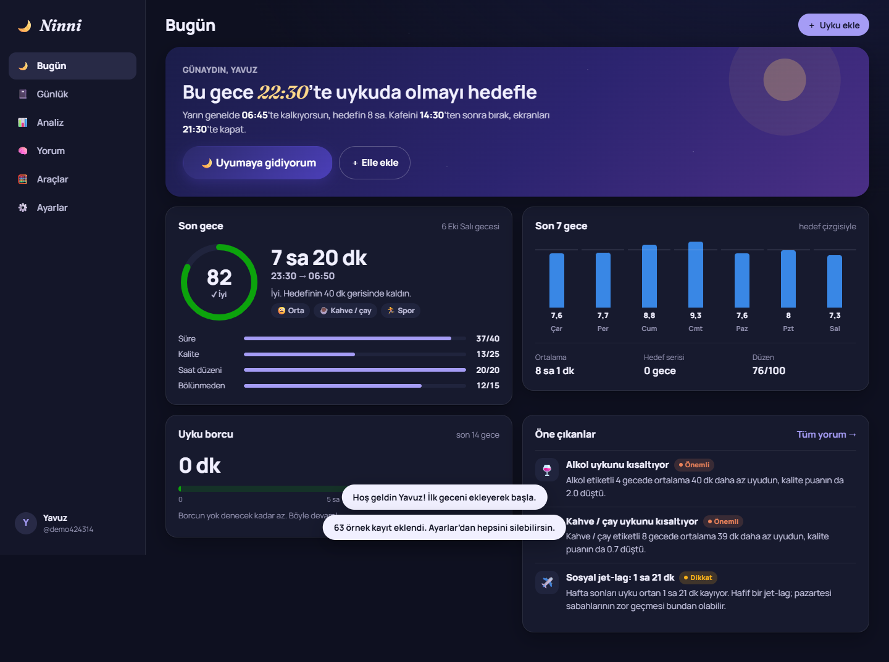
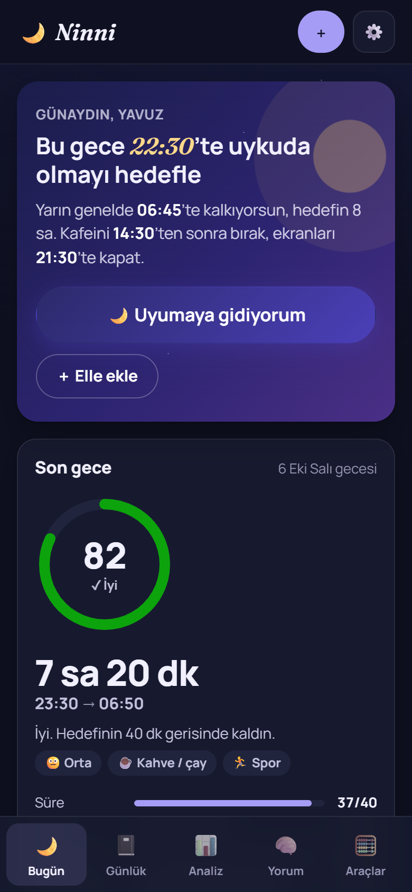
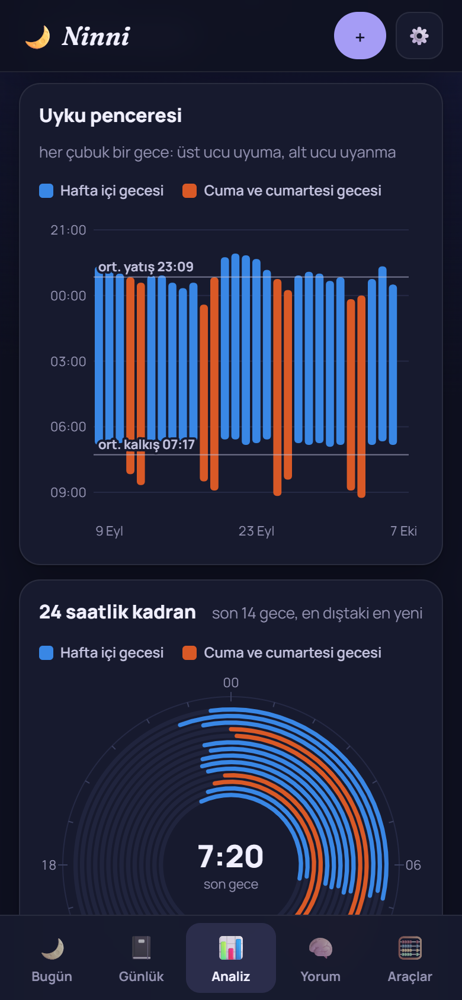
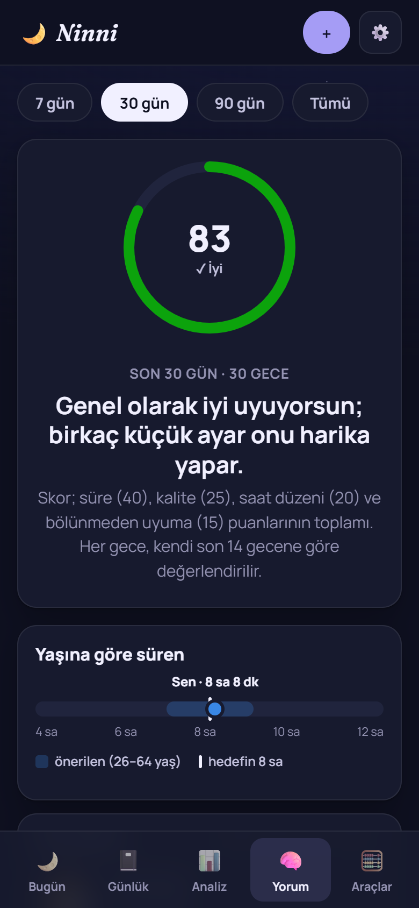
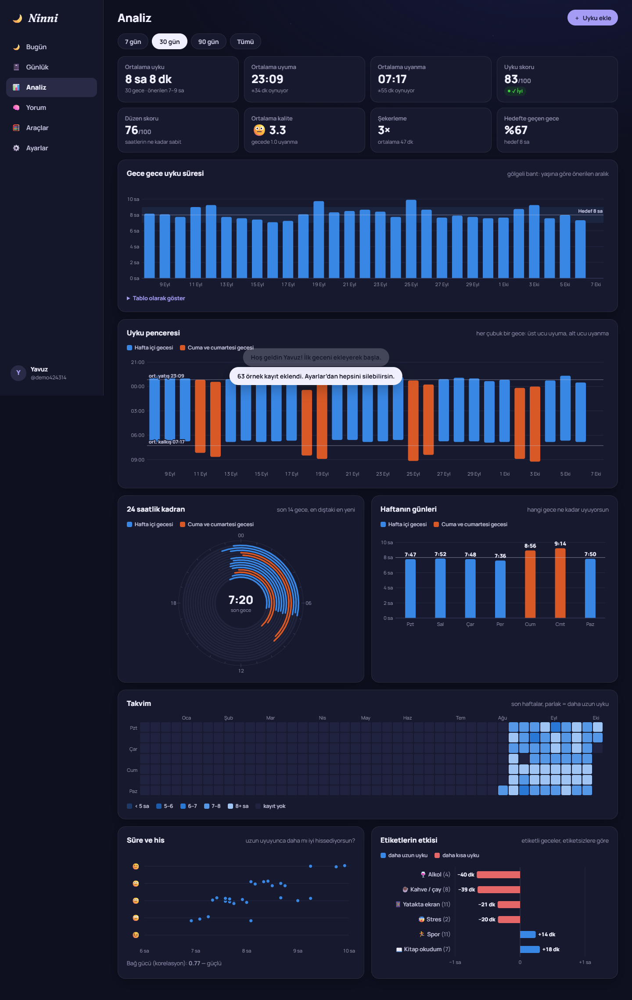
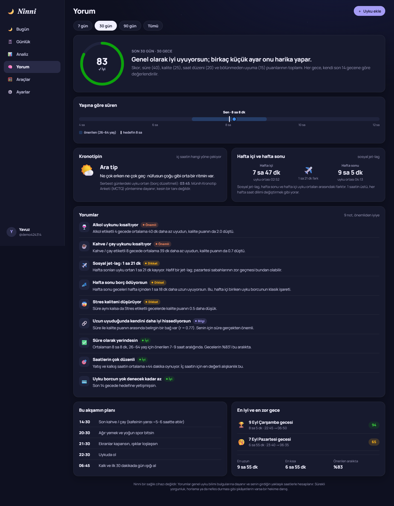
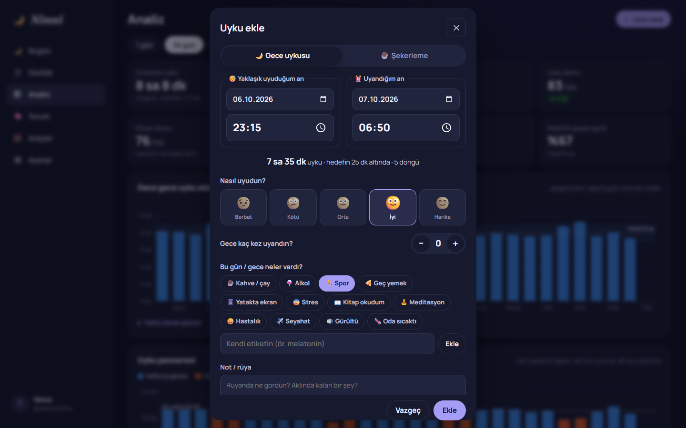
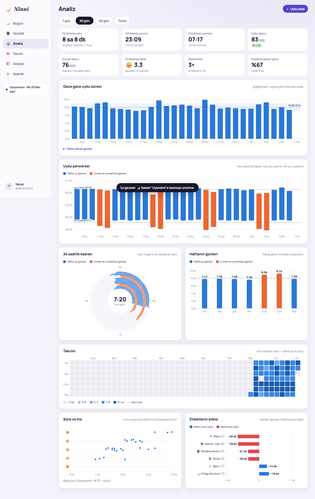

# 🌙 Ninni

**A sleep tracker that reads your nights back to you.**

*Ninni* is the Turkish word for "lullaby". You tell it roughly when you fell asleep and when you woke up, either with one tap at bedtime and one in the morning or by typing the times later. Ninni turns those nights into a sleep score, a sleep-debt meter, your chronotype, your social jetlag and plain-language notes on what helps and hurts your sleep, with charts for all of it. Sign in with the same account on your phone and your computer and everything stays in sync.

> 🤖 **This project was vibe coded.** It was built by describing the idea in plain Turkish to an AI coding assistant (Claude Code) and iterating on the result together. A person tested it and steered the design, but no one wrote it line by line. Read the code before you rely on it for anything important.

> [!WARNING]
> **Ninni is not a medical device.** Its notes are based on general sleep research and on the approximate times you enter. If you are always tired, snore heavily or stop breathing in your sleep, see a doctor.

<p align="center">
  
</p>

<p align="center">
  
  &nbsp;
  
  &nbsp;
  
</p>

## Features

**Logging**
- **"I'm going to sleep" / "I woke up".** Tap once at night and once in the morning. A running sleep is stored on the server, so you can start it on your phone and finish it on your laptop. If you didn't fall asleep right away, you can correct the start time.
- **Manual entry** with date and time pickers. Times you type are taken as "roughly when I fell asleep". If the wake time is earlier on the clock than the bedtime, the wake date moves to the next morning by itself.
- **Night sleep or nap**, a 1–5 quality face, how many times you woke up, a note or dream, and tags: coffee, alcohol, exercise, late meal, screens in bed, stress, reading, meditation, illness, travel, noise, a hot room, or your own.
- A night split in pieces (woke at 3, slept again) is counted as one night with the gap removed.

**Charts** (hover on desktop, tap on a phone)
- **Night-by-night duration** with your goal and the recommended range for your age, plus a table view.
- **Sleep window:** one bar per night from falling asleep to waking up, weekdays and Friday/Saturday nights in different colors, with average bedtime and wake-time lines.
- **24-hour dial:** the last 14 nights drawn as rings around a clock face.
- **By weekday**, a **calendar heatmap**, **duration vs. how you felt** (with the correlation), and **tag effects**: how much longer or shorter you sleep on nights with each tag.

**The reading**
- **Sleep score (0–100)** for every night and every period: duration 40, quality 25, timing compared with your own last 14 nights 20, unbroken sleep 15.
- **Sleep debt** over the last 14 nights against your goal. Extra sleep pays it back.
- **Regularity score** from how much your bed and wake times wander.
- **Social jetlag:** the gap between your mid-sleep on free nights and on work nights.
- **Chronotype** from mid-sleep on free days corrected for catch-up sleep (the MCTQ method), from "clear morning type" to "night owl".
- **Tag effects that are fair.** Each tagged night is compared with untagged nights of the same kind (workday or free night), so a tag that mostly happens on weekends doesn't get credit for weekend lie-ins.
- **Written notes**, sorted from most to least important and marked Important, Attention, Info or Good. Examples: "Coffee is shortening your sleep: 39 min less on 8 coffee nights", "Social jetlag: 1 h 21 min", "You're paying back debt at the weekend".
- **Tonight's plan:** a suggested bedtime from your usual wake time for tomorrow, your goal and any debt, plus when to stop caffeine and screens.

**Tools**
- Sleep-cycle calculator in both directions: "when should I go to bed to wake at 07:00?" and "if I go to bed now, when should I wake?"
- Eight sleep-hygiene habits that actually help.

**Comfort**
- Works on phones, tablets and desktops: a sidebar on large screens, a bottom tab bar and bottom-sheet forms on phones. You can add it to your home screen.
- Night, day and system themes.
- Your data: CSV export (opens in Excel), JSON backup and restore, 60 nights of sample data to explore the charts, and deleting everything.
- Turkish interface.

<p align="center">
  
</p>

<p align="center">
  
</p>

<p align="center">
  
  &nbsp;
  
</p>

## Tech

Kept small on purpose, the same way as [Günce](https://github.com/yavuzkrm/gunce):

| Part | Choice |
| --- | --- |
| Server | Node.js 20+, Express |
| Database | SQLite through `better-sqlite3`, stored in one file |
| Frontend | Plain HTML, CSS and ES modules. No framework and no build step |
| Charts | Hand-written SVG. The colors were checked for color-blind safety and contrast in both themes |
| Auth | Username and password hashed with scrypt. Sessions are random tokens stored hashed, in an `HttpOnly` `SameSite=Lax` cookie |
| Tests | `node:test` tests for the API and the sleep math (`npm test`) |

```
server/
  index.js       starts the HTTP server
  app.js         routes, validation, auth, export/import
  db.js          schema and connection
public/
  index.html     app shell
  app.js         screens, forms, sync
  analysis.js    all sleep math and the written notes (pure functions, unit tested)
  charts.js      SVG charts
  styles.css     tokens, layout, night/day themes
test/
  api.test.js
  analysis.test.mjs
```

Times are stored as the wall-clock time you entered (`2026-10-06T23:30`), with no time zone. Each night is measured on a timeline that starts at 18:00 of its evening, so going to bed after midnight doesn't break averages.

## Run it locally

You need [Node.js](https://nodejs.org) 20 or newer.

```bash
git clone https://github.com/yavuzkrm/ninni.git
cd ninni
npm install
npm start          # http://localhost:3000
npm test           # API and analysis tests
```

The database is created at `./data/ninni.db`.

| Variable | Default | Meaning |
| --- | --- | --- |
| `PORT` | `3000` | HTTP port |
| `DATA_DIR` | `./data` | Folder that holds `ninni.db` |
| `DB_FILE` | – | Full path to the database file (overrides `DATA_DIR`) |
| `NODE_ENV` | – | Set to `production` to mark cookies `Secure` (HTTPS only) |

## Deploy

### Railway

1. Sign in at [railway.com](https://railway.com) with your GitHub account.
2. Go to **New Project → Deploy from GitHub repo** and pick this repository. The included `Dockerfile` and `railway.json` are used automatically.
3. Add a **volume** to the service and set its mount path to **`/data`** (**Ctrl/⌘ + K → Add Volume**, or right-click the service). Without a volume, every deploy wipes the database.
4. Go to **Settings → Networking → Generate Domain**. Your site will be at `https://<something>.up.railway.app`.
5. Every push to `main` redeploys automatically.

The Docker image already sets `NODE_ENV=production` and `DATA_DIR=/data`, and Railway's health check uses `/api/health`. SQLite lives on one disk, so keep the service at **one replica**.

### Docker anywhere

```bash
docker build -t ninni .
docker run -p 3000:3000 -v ninni-data:/data ninni
```

The image runs with `NODE_ENV=production`, so the session cookie needs HTTPS. To try it over plain `http://localhost`, add `-e NODE_ENV=development`.

## API

All endpoints are under `/api`, and request and response bodies are JSON. Requests that change data must send `Content-Type: application/json`. Together with the `SameSite` cookie, this blocks cross-site form posts (CSRF).

| Method | Path | |
| --- | --- | --- |
| POST | `/auth/register` · `/auth/login` · `/auth/logout` | |
| GET / PATCH / DELETE | `/me` | profile, goal, age group, password; account deletion |
| POST / DELETE | `/live` | start (`{ at }`) or cancel a running sleep |
| GET / POST | `/sleeps` | list / add (`endLive: true` also stops the running sleep) |
| PATCH / DELETE | `/sleeps/:id` | edit / delete |
| POST | `/sleeps/import` | `{ sleeps: [...] }`; overlapping rows are skipped |
| DELETE | `/sleeps` | delete all sleeps (`{ password }`) |
| GET | `/export?format=csv\|json` | download |

## Privacy notes

- Passwords are never stored in plain text (scrypt with a per-user salt).
- Every sleep belongs to one account and only that account can read it.
- Deleting your account deletes all its sleeps.
- There is no email and no password reset. If someone forgets their password, the server admin has to help.

## How this was made

Ninni was built in one conversation with Claude Code. The request, roughly: "Make me a sleep tracker, but not an ordinary one. The user enters about when they fell asleep and woke up, and beyond that it should turn the data into charts and interpret how they slept. It should work on phones and computers, and I'll deploy it on Railway like my other projects." Claude reused the server setup from Günce, wrote the analysis and the charts, tested the API and the sleep math, and checked every screen in a headless browser at desktop and phone sizes in both themes. One fix came out of those screenshots: the sample data showed alcohol *adding* an hour of sleep, because people mostly drink on weekend nights. Tag effects are now compared within workdays and within free nights.

If you find a bug, feel free to open an issue. Fixes will most likely be vibe-coded too.

## License

This project is licensed under the [MIT License](LICENSE).
